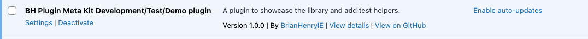

# BH Plugin Meta Kit

A `plugins.php` helper library for WordPress plugins which are not hosted on WordPress.org. It adds links in row meta and uses `readme.txt` to populate the `View details` modal.



```php
/**
 * Plugin Name:   My Plugin
 * ...
 * Settings Link: options-general.php?page=my-plugin
 * GitHub Link:   https://github.com/example/my-plugin
 */
```

# Install

```bash
composer require brianhenryie/bh-wp-plugin-meta-kit
```

The library's `files` autoloader loads `bootstrap.php` which checks for and loads `bootstrap2.php` which infers the 
settings to use with the library. You can delete `bootstrap2.php` and instantiate it directly yourself.

When using libraries in WordPress plugins, you need to isolate dependencies with a tool such as [Strauss](https://github.com/BrianHenryIE/strauss).

## Features

In addition to the `plugins.php` `Settings` link and `View details` modal...

### Activation notice

For a week after your plugin is activated, users who can manage options see a notice linking to its settings screen. It stops once someone visits that screen, and each user can dismiss it.


It needs the `Settings Link` header, or `settings_url`.

### Dependencies notice

Tell the library what your plugin needs, and users who can deactivate plugins see a notice for each thing the site is missing, with a link to deactivate the plugin. Each user can dismiss it.


Dependencies cannot be read from the plugin's headers, so this needs your own settings, below.
