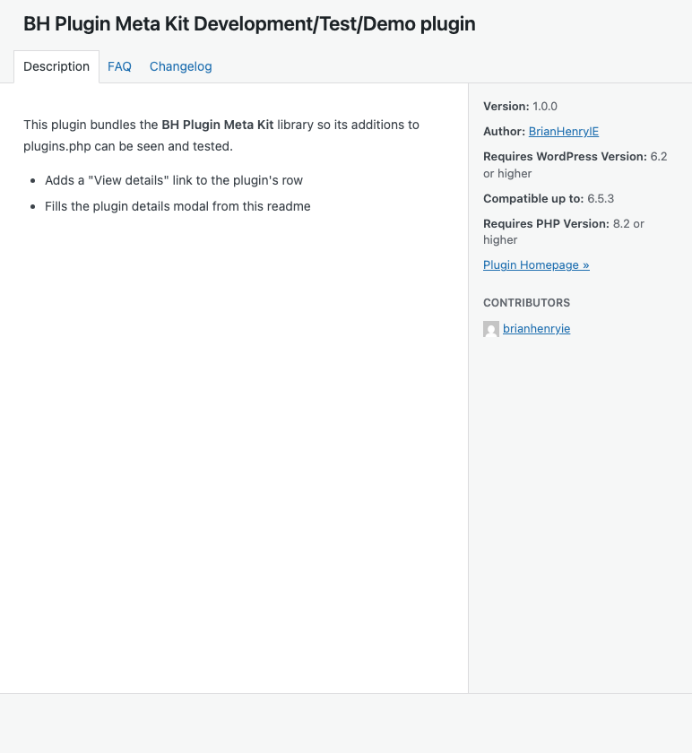
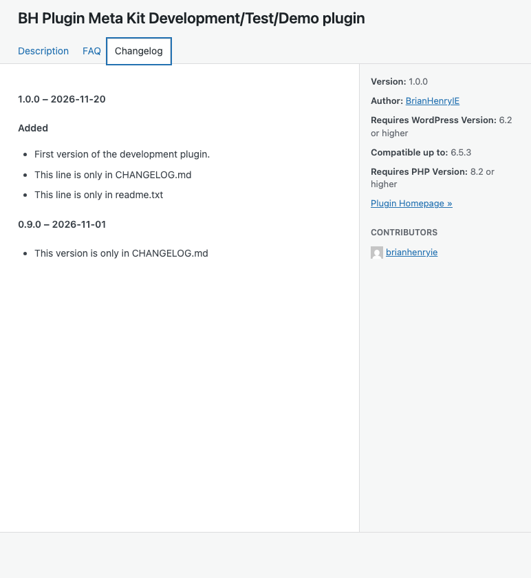
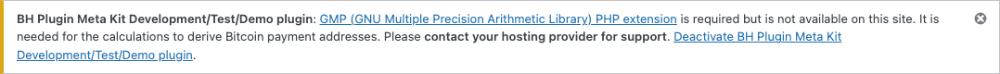

# BH Plugin Meta Kit

A library for WordPress plugins which are not hosted on WordPress.org. It fills in what WordPress shows for a plugin on plugins.php, mostly from files the plugin already has: its main file's headers, its `readme.txt` and its `CHANGELOG.md`.


* A **Settings** link in the plugin's row on plugins.php
* A **View details** link, which WordPress otherwise only prints for plugins from WordPress.org, opening the plugin details modal filled from the plugin's headers and `readme.txt`
* A **Changelog** tab in that modal which merges `CHANGELOG.md` with the readme's changelog
* A **View on GitHub** link in the plugin's row
* A **Settings** link on the screen shown after the plugin is installed
* An **admin notice for a week after activation**, inviting administrators to the plugin's settings
* An **admin notice for each dependency** the site is missing, e.g. a PHP extension

Requires PHP 8.2.

## Install

```bash
composer require brianhenryie/bh-wp-plugin-meta-kit
```

It is not on Packagist yet. Until it is, tell Composer where the repository is first:

```bash
composer config repositories.brianhenryie/bh-wp-plugin-meta-kit vcs https://github.com/BrianHenryIE/bh-wp-plugin-meta-kit
composer require brianhenryie/bh-wp-plugin-meta-kit:dev-master
```

That is all a plugin has to do: the library has a `files` autoloader, so it starts itself once your plugin has required Composer's `vendor/autoload.php`. It works out which plugin it is in from where it is installed, `wp-content/plugins/{your-plugin}/vendor/…`, and reads that plugin's main file.

If more than one active plugin might bundle the library, prefix it, e.g. with [Strauss](https://github.com/BrianHenryIE/strauss). Without a prefix only the first copy loaded runs.

## Plugin headers

Two headers in your plugin's main file switch on the links:

```php
/**
 * Plugin Name:   My Plugin
 * Plugin URI:    https://example.org/my-plugin
 * Version:       1.2.3
 * Author:        Example Author
 * Author URI:    https://example.org
 * Settings Link: options-general.php?page=my-plugin
 * GitHub Link:   https://github.com/example/my-plugin
 */
```

| Header | Value | Used for |
|---|---|---|
| `Settings Link` | Relative to wp-admin, or a full URL | The Settings links and the activation notice |
| `GitHub Link` | A full URL, or `owner/repository` | The View on GitHub link |

Neither is one of WordPress's own headers. Without one, the links which need it are left out.

## What it adds

### Links on plugins.php

**Settings** is added before Deactivate, and **View on GitHub** after the version and author. Other plugins' rows are not touched.

### Plugin details modal

**View details** opens the same modal WordPress uses for plugins from WordPress.org.



| Shown | Comes from |
|---|---|
| Version, Author, Plugin Homepage | The `Version`, `Author` / `Author URI` and `Plugin URI` headers |
| Requires WordPress Version, Requires PHP Version | The `Requires at least` and `Requires PHP` headers, otherwise the readme |
| Compatible up to | The readme's `Tested up to` |
| Contributors | The readme's `Contributors`, linked to their WordPress.org profiles |
| Description, FAQ and other tabs | The sections of the readme, including ones WordPress.org does not know |

The readme is found whatever its capitalisation: `readme.txt`, `README.txt`, `Readme.txt`.

WordPress warns that a plugin "has not been tested with your current version of WordPress" when the readme says `Tested up to: 6.5` and the site runs 6.5.3. The library treats a patch release of the tested version as tested.

### Changelog tab

When the plugin has a `CHANGELOG.md`, the Changelog tab shows it merged with the changelog in `readme.txt`, version by version. It is easy to update one file for a release and forget the other, so each version gets the lines of both, and a line which is in both is shown once.



* Lines are the same if they only differ in their list marker, emphasis, capitalisation, spacing or a closing full stop.
* Version headings can be written `## [1.2.0] - 2026-01-31`, `## 1.2.0`, `### v1.2.0` or `= 1.2.0 =`.
* Versions are shown newest first, with the date when either file gives one.
* What is under `## [Unreleased]` is left out.
* Without a `CHANGELOG.md`, the tab shows the readme's changelog as it is.

### Activation notice

For a week after your plugin is activated, users who can manage options see a notice linking to its settings screen. It stops once someone visits that screen, and each user can dismiss it.


It needs the `Settings Link` header, or `settings_url`.

### Dependencies notice

Tell the library what your plugin needs, and users who can deactivate plugins see a notice for each thing the site is missing, with a link to deactivate the plugin. Each user can dismiss it.



Dependencies cannot be read from the plugin's headers, so this needs your own settings, below.

## Your own settings

To pass settings yourself, replace the zero-config setup:

```php
use BrianHenryIE\Plugin_Meta_Kit\Model\Dependency;
use BrianHenryIE\Plugin_Meta_Kit\Plugin_Meta_Kit;
use BrianHenryIE\Plugin_Meta_Kit\Plugin_Meta_Kit_Settings;

use function BrianHenryIE\Plugin_Meta_Kit\is_relevant_request;

remove_action( 'admin_init', 'BrianHenryIE\\Plugin_Meta_Kit\\initialize_plugin_meta_kit' );

add_action(
	'admin_init',
	function () {
		// Optional: skips the admin-ajax.php requests, e.g. the Heartbeat, the library has no part in.
		if ( ! is_relevant_request() ) {
			return;
		}

		Plugin_Meta_Kit::initialize(
			new Plugin_Meta_Kit_Settings(
				plugin_slug: 'my-plugin',
				plugin_basename: 'my-plugin/my-plugin.php',
				plugin_name: 'My Plugin',
				dependencies: array(
					new Dependency(
						name: 'GMP (GNU Multiple Precision Arithmetic Library) PHP extension',
						is_satisfied: fn (): bool => extension_loaded( 'gmp' ),
						description: 'It is needed for the calculations to derive Bitcoin payment addresses. Please <strong>contact your hosting provider for support</strong>.',
						url: 'https://www.php.net/manual/en/book.gmp.php',
					),
				),
				settings_url: admin_url( 'options-general.php?page=my-plugin' ),
				github_url: 'https://github.com/example/my-plugin',
			),
			$logger, // Optional: a PSR-3 logger.
		);
	}
);
```

| Setting | |
|---|---|
| `plugin_slug` | The plugin's directory name |
| `plugin_basename` | The plugin's main file, relative to the plugins directory |
| `plugin_name` | The plugin's name |
| `dependencies` | `Dependency` objects: a name, a check returning true when the site has it, and optionally a description and a link |
| `settings_url` | The full URL of the plugin's settings screen |
| `github_url` | The full URL of the plugin's GitHub repository |

A few things to know:

* **A dependency's check runs on every wp-admin page** for users who can deactivate plugins, so keep it cheap. One which throws shows no notice and is logged.
* **To keep what the library infers** and only add to it, call `BrianHenryIE\Plugin_Meta_Kit\make_settings()` and copy its properties into your own settings.
* **The activation notice needs the activation recorded.** The zero-config setup does that. With your own, call `activation()` as your plugin's file is loaded, as you would `register_activation_hook()`; `admin_init` is too late:

  ```php
  ( new Plugin_Meta_Kit( $settings ) )->activation();
  ```

* **Dismissed notices** are remembered per user. To show them again to everyone:

  ```php
  Plugin_Meta_Kit::get_instance()?->reset_dismissed_notices();
  ```

To switch the library off entirely, delete its `bootstrap2.php`, or remove the `admin_init` action as above.

## Development

The library has no plugin of its own. `development-plugin` is a small plugin which bundles it, with an example dependency and a settings screen which switches that dependency's notice on and resets dismissed notices.

```bash
composer install
npm install
npx wp-env start   # http://localhost:8884, admin / password
```

| | |
|---|---|
| Unit and integration tests | `vendor/bin/codecept run unit` and `vendor/bin/codecept run wpunit` (the latter uses wp-env's database) |
| End-to-end tests | `npx playwright test` |
| Fix and check code style, and static analysis | `composer cs-fix` |
| Retake the screenshots above | `UPDATE_DOCS_SCREENSHOTS=1 npx playwright test tests/e2e-pw/docs-screenshots.spec.ts --project=chromium` |

## Ideas

* An API to add more links on plugins.php.
* Scan the admin menu after `plugins_loaded` to find the settings screen, rather than needing the header.
* How to handle conditional menu items? (e.g. settings only appear when WooCommerce is active.)
* A Screenshots tab in the plugin details modal.
* A GitHub Action step to confirm the readme has been updated since the last release: version and changelog.
